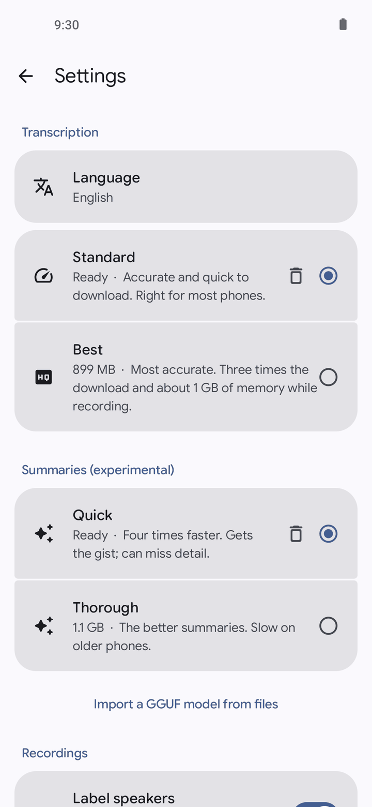
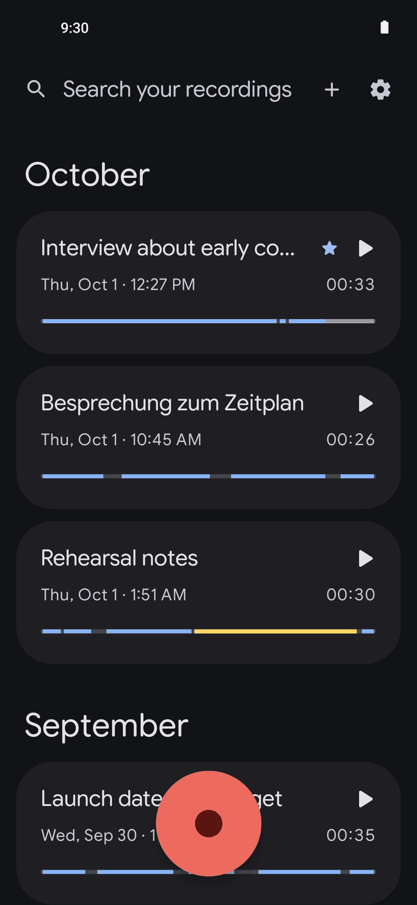

<div align="center">


# Sotto Recorder

**A voice recorder that writes down what is said as you speak. Everything stays on the phone.**

[](https://apps.obtainium.imranr.dev/redirect?r=obtainium://add/https://github.com/PimpinPumpkin/sotto)&nbsp;&nbsp;[](https://github.com/PimpinPumpkin/sotto/releases/latest)

Android 10 or later, 64-bit. No account, no cloud, no Google services.

</div>

| Library | Live transcript | Music and speech | Speakers | Summary |
|:-:|:-:|:-:|:-:|:-:|
|  |  |  |  |  |

| Playback | Search | Settings | Dark: library | Dark: transcript |
|:-:|:-:|:-:|:-:|:-:|
|  |  |  |  |  |

## Features

- **Live transcript.** Words appear while you talk, and each sentence is tidied up when you pause.
- **Tap a word to hear it.** The word being played is highlighted.
- **Speaker labels** you can rename, merge, or correct from any word.
- **Fix the text**, during or after recording.
- **Crop and cut** by selecting on the waveform or across the words.
- **Music, applause and laughter** shown in their own colors.
- **Search** every recording at once, or inside one.
- **Summaries**, written on the phone, ready to copy or share. Optional.
- **Import audio files** and transcribe them.
- **Export** audio, text, subtitles or word timings.
- **English, German, French and Spanish.**
- **Background playback**, lock screen controls, a widget and a quick settings tile.
- **Back up and restore** the whole library.
- **Private.** Nothing you record or say leaves the phone.

Sotto Recorder is a free-software take on Google's Recorder app, and is not affiliated with
Google. It is new, so expect a bug or two;
[open an issue](https://github.com/PimpinPumpkin/sotto/issues) if you find one.

---

## More

<details>
<summary><b>Installing and updates</b></summary>

<br>

**Obtainium** (recommended) installs the app and keeps it updated. **Download APK** takes you to
the latest release: download the `.apk` file and open it.

| Channel | What it is | How often |
| --- | --- | --- |
| **Stable** | The newest nightly, promoted | Weekly |
| **Nightly** | Built from `main` | Every day `main` changes |
| **Canary** | Built from the `canary` branch | Every push |

All three share one signing key and one rising version code, so moving between them is a plain
update.

</details>

<details>
<summary><b>Check you got the real thing</b></summary>

<br>

Every Sotto Recorder APK, from any channel, is signed with the same key. Its certificate
fingerprint is:

```
SHA-256  6B:46:17:27:C0:0D:04:FC:20:60:45:55:2D:A9:5C:36:7F:AB:37:A3:21:EA:37:CF:E4:81:86:BC:D0:EC:D3:FE
```

Check a downloaded file against it before installing:

```bash
apksigner verify --print-certs sotto-recorder-*.apk
```

On the phone, [App Verifier](https://github.com/soupslurpr/AppVerifier) checks the same thing. It
wants the package name on the first line and the fingerprint on the second:

```
app.sotto
6B:46:17:27:C0:0D:04:FC:20:60:45:55:2D:A9:5C:36:7F:AB:37:A3:21:EA:37:CF:E4:81:86:BC:D0:EC:D3:FE
```

Android enforces this for you after the first install: an update signed with a different key is
refused.

</details>

<details>
<summary><b>Models and download sizes</b></summary>

<br>

Nothing is transcribed until a speech model is on the phone. The app offers to download one on
first launch.

| Language | Standard (default) | Best |
| --- | --- | --- |
| English | 346 MB | 899 MB |
| German, French | 172 MB | 842 MB |
| Spanish | 257 MB | 927 MB |

- Best uses about 1.1 GB of memory while recording.
- The sizes include the 97 MB voice model behind speaker labels. Turn speaker labels off and it
  is not downloaded.
- Summaries need a separate model: Quick (676 MB) or Thorough (1.1 GB). Any other GGUF chat model
  can be imported instead.

To skip the in-app download, fetch the files on another device and use "Import from files" in
Settings.

When a later version moves to a newer model, the one you have keeps working until you update it.

</details>

<details>
<summary><b>Privacy</b></summary>

<br>

| What you do | Who hears about it |
| --- | --- |
| Record, transcribe, label speakers, summarize, search | **Nobody.** All of it runs on the phone |
| Download a model | **GitHub or Hugging Face**, which see a file download and nothing else |
| Import a model from files instead | **Nobody** |
| Export or share a recording | **Whichever app you send it to** |

No analytics, no crash reporting, no accounts. Model downloads are the only time the app uses the
network. On a system that lets you withhold the network permission from an app, Sotto runs fine
without it once its models are in place.

Recordings are kept in the app's private storage. Other apps see one only when you export it,
share it, or pick it in the system file picker.

</details>

<details>
<summary><b>How it works</b></summary>

<br>

Transcription is two passes, both on the CPU through
[sherpa-onnx](https://github.com/k2-fsa/sherpa-onnx):

1. A streaming model produces the words you see appear.
2. At each pause, a larger model hears the whole sentence and rewrites it with punctuation,
   capitals and better word timings.

| Language | Live | Second pass |
| --- | --- | --- |
| English | NVIDIA FastConformer | Parakeet TDT 110M (Standard) or 0.6B v2 (Best) |
| German, French, Spanish | Kroko streaming Zipformer | None (Standard) or Parakeet TDT 0.6B v3 (Best) |

The Kroko models punctuate as they go, so their text can stand as the transcript.

- **Sounds**: CED tiny, inside the APK, tags music, applause and laughter.
- **Speakers**: pyannote segmentation finds where the voice changes, and NVIDIA TitaNet groups
  the voices. Runs once when a recording is saved. Skipped for recordings over 45 minutes.
- **Summaries**: Qwen2.5 through [llama.cpp](https://github.com/ggml-org/llama.cpp), held by a
  grammar to a title and one to five sentences. Small models get facts wrong, so this is marked
  experimental.
- **Audio**: AAC, 48 kHz mono, written so that a recording survives the app being killed.
  Cropping copies audio frames without re-encoding.

Each version of the app pins the exact model files it uses by SHA-256. They are fetched from the
[`models` release](https://github.com/PimpinPumpkin/sotto/releases/tag/models) here, which holds
unmodified copies, and from the original publisher if that fails.

</details>

<details>
<summary><b>Known gaps</b></summary>

<br>

- Four languages. Adding one needs a good open streaming model, and few languages have one.
- The app's own text is English only.
- The Bluetooth microphone option and pausing for phone calls have not been tested on real
  hardware.
- Not on F-Droid yet. See [docs/FDROID.md](docs/FDROID.md).

</details>

<details>
<summary><b>Building and contributing</b></summary>

<br>

```bash
./gradlew assembleDebug
```

JDK 17, Android SDK platform 37, the NDK and CMake. The first build downloads the sherpa-onnx
library, a trimmed ONNX Runtime and two small bundled models, and fetches llama.cpp at its pinned
tag. Pass `-PllamaSrc=<checkout>` to build llama.cpp from a local copy.

```bash
./gradlew testDebugUnitTest
```

runs the tests: word timing, transcript edits and cuts, speaker changes, resampling and audio
framing.

Debug builds can record from a WAV file (16-bit mono, 16 or 48 kHz) instead of the microphone:

```bash
adb push clip.wav /data/local/tmp/clip.wav
adb shell run-as app.sotto cp /data/local/tmp/clip.wav files/clip.wav
adb shell am start -n app.sotto/.MainActivity --es wav /data/user/0/app.sotto/files/clip.wav
```

After adding a model, rerun `scripts/build-onnxruntime.sh`: the bundled runtime only carries the
operators the current models use.

Issues and pull requests are welcome. Two house rules, both checked by `scripts/check-writing.sh`
and by CI: US English, and no em dashes. Commit subjects are used verbatim as release notes, so
write them as plain sentences about what changed for the person using the app.

</details>

## License

GPL-3.0. See [LICENSE](LICENSE).

| Component | License |
| --- | --- |
| [sherpa-onnx](https://github.com/k2-fsa/sherpa-onnx), llama.cpp, ONNX Runtime | Apache 2.0, MIT |
| NVIDIA FastConformer, Parakeet TDT and TitaNet | CC BY 4.0 |
| Banafo Kroko ASR | CC BY-SA 4.0 |
| CED tiny, Qwen2.5 | Apache 2.0 |
| pyannote segmentation 3.0 | MIT |
| [Google Sans Flex](https://fonts.google.com/specimen/Google+Sans+Flex) | OFL 1.1, see [licenses/](licenses/GoogleSansFlex-OFL.txt) |
| AndroidX, Compose, Media3, Commons Compress | Apache 2.0 |
