<div align="center">

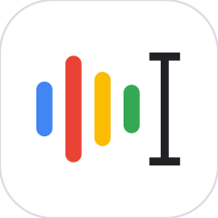

# Alyo

**Speech for your phone, without Google: voice typing and a recorder that transcribes as you talk.**

[](https://apps.obtainium.imranr.dev/redirect?r=obtainium://add/https://github.com/PimpinPumpkin/alyo)&nbsp;&nbsp;[](https://github.com/PimpinPumpkin/alyo/releases/latest)

Android 10 or later, 64-bit. No account, no cloud, no Google services.

</div>

| Alyo | Voice typing | Recorder | Live transcript | Speakers |
|:-:|:-:|:-:|:-:|:-:|
| 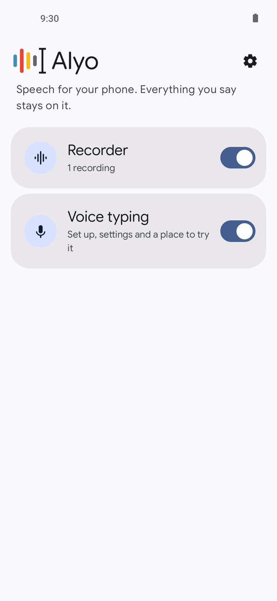 | 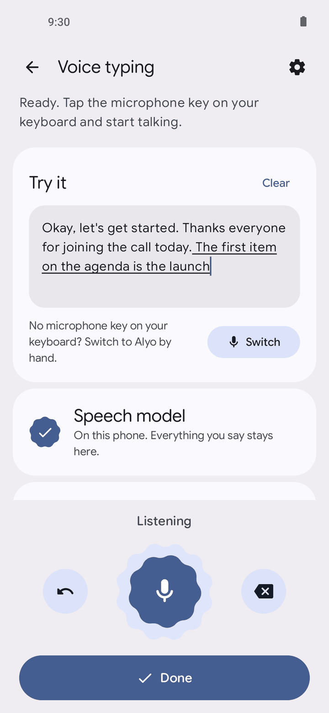 | 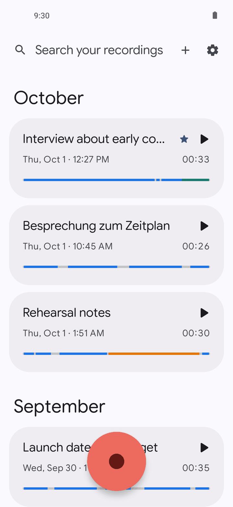 | 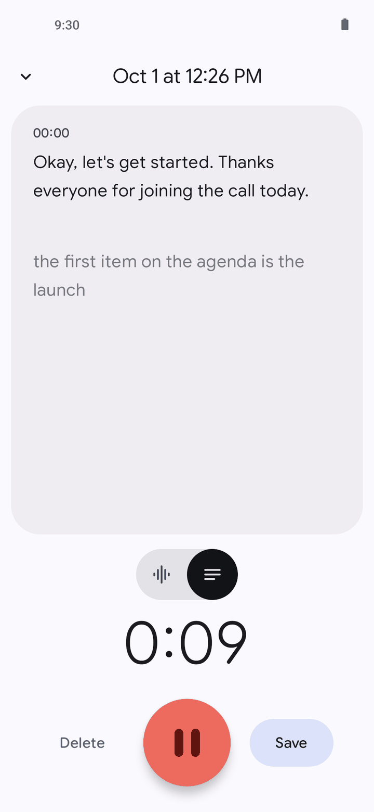 | 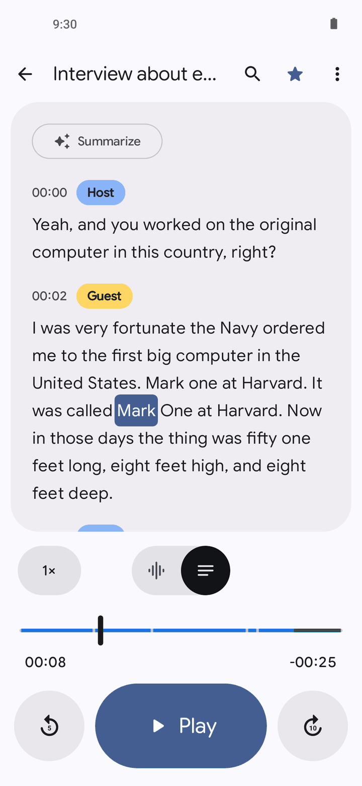 |

| Music and speech | Summary | Playback | Search | Dark |
|:-:|:-:|:-:|:-:|:-:|
| 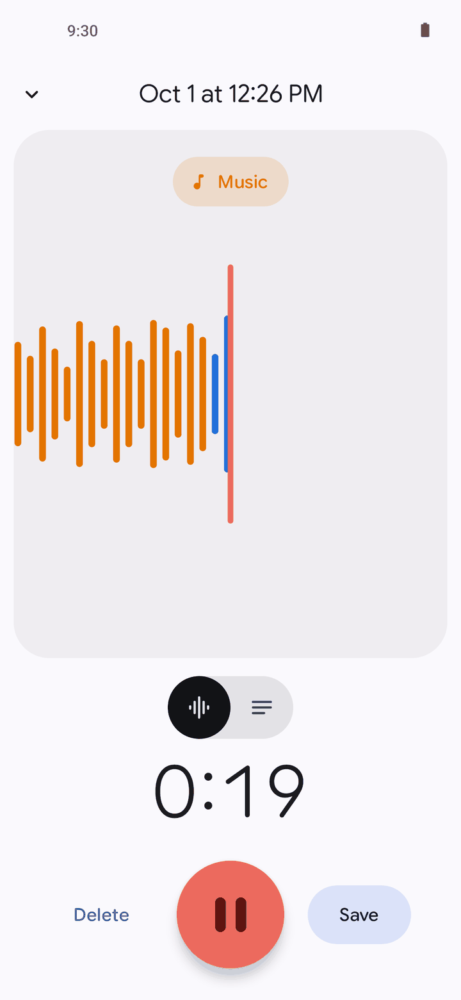 | 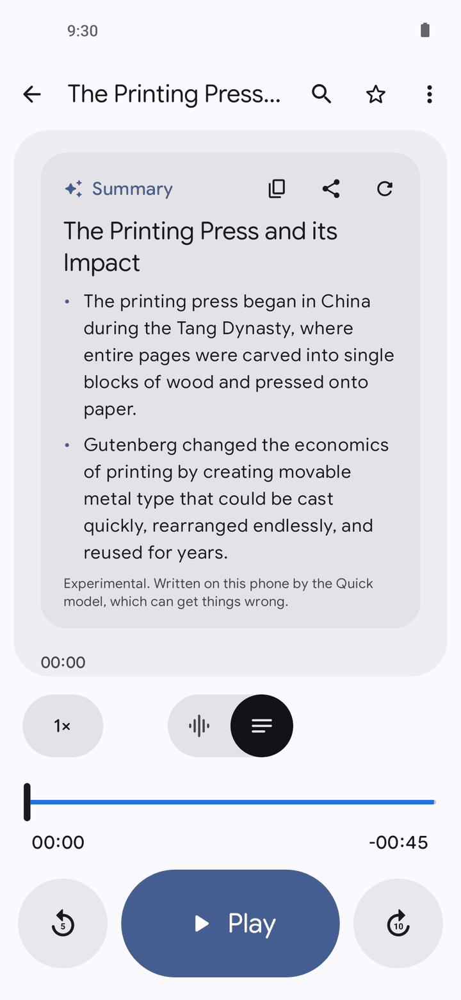 | 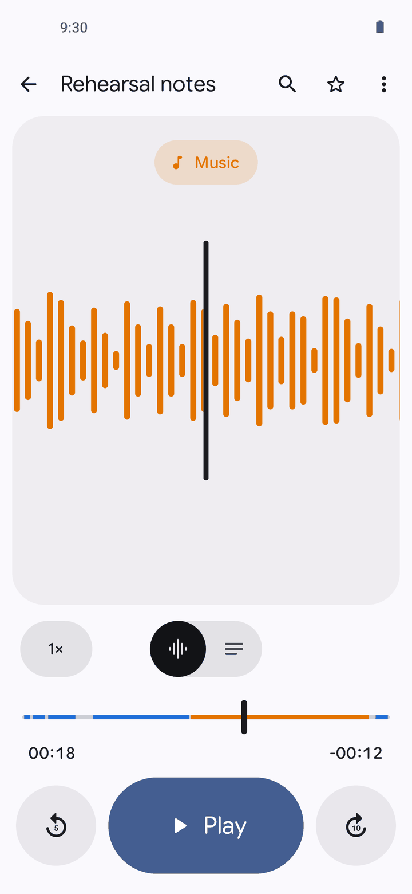 | 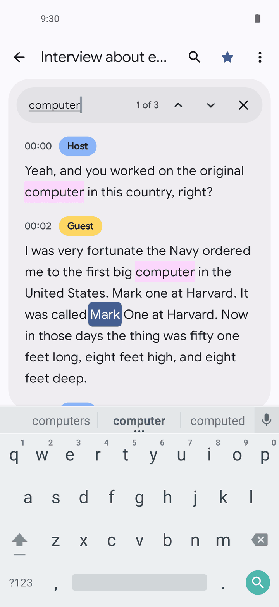 | 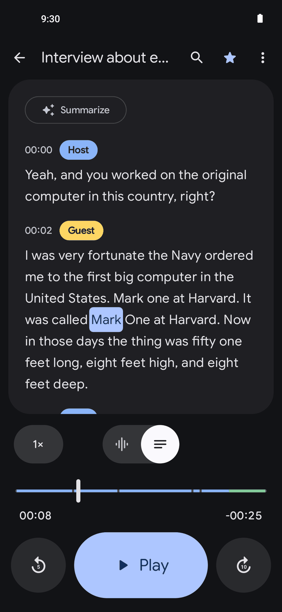 |

Alyo is one app with two jobs. Turn on either or both; what you leave off stays out of your way.
Both use the same speech models, so they are downloaded and kept only once.

## Voice typing

- **Type by talking, in any app.** The microphone key on your keyboard opens it.
- **Words appear as you speak**, not after you stop.
- **Punctuation and capitals** are added for you, or say "comma", "period", "new line".
- **Undo the last sentence** or backspace a word, without leaving the panel.
- **Hands the keyboard back** after a few seconds of silence.
- **Works for apps that ask Android for speech**, such as a search box with a microphone.

## Recorder

- **Live transcript.** Words appear while you talk, and each sentence is tidied up when you pause.
- **Tap a word to hear it.** The word being played is highlighted.
- **Speaker labels** you can rename, merge, or correct from any word.
- **Fix the text**, during or after recording.
- **Crop and cut** by selecting on the waveform or across the words.
- **Music, applause and laughter** shown in their own colors.
- **Search** every recording at once, or inside one.
- **Summaries**, written on the phone, ready to copy or share. Optional.
- **Import audio files** and transcribe them.
- **Export** audio, text, subtitles or word timings.
- **Background playback**, lock screen controls, a widget and a quick settings tile.
- **Back up and restore** the whole library.
- **Its own icon.** With the recorder on, a "Recorder" icon opens straight into it.

## Both

- **Private.** Nothing you say leaves the phone.
- **English, German, French and Spanish** in the recorder. Voice typing is English for now.

The recorder is a free-software take on Google's Recorder app. Alyo is not affiliated with Google.
It is new, so expect a bug or two; [open an issue](https://github.com/PimpinPumpkin/alyo/issues)
if you find one.

---

## More

<details>
<summary><b>Installing and updates</b></summary>

<br>

**Obtainium** (recommended) installs the app and keeps it updated. **Download APK** takes you to
the latest release: download the `.apk` file and open it.

| Channel | What it is | How often |
| --- | --- | --- |
| **Stable** | The newest nightly, promoted | Weekly |
| **Nightly** | Built from `main` | Every day `main` changes |
| **Canary** | Built from the `canary` branch | Every push |

All three share one signing key and one rising version code, so moving between them is a plain
update.

</details>

<details>
<summary><b>Check you got the real thing</b></summary>

<br>

Every Alyo APK, from any channel, is signed with the same key. Its certificate fingerprint is:

```
SHA-256  CB:9E:B9:4D:CD:F0:3B:A7:D6:B4:52:FE:64:E5:4C:DA:39:FB:DF:90:AE:94:72:02:FE:3D:1A:E9:BF:F2:FA:EB
```

Check a downloaded file against it before installing:

```bash
apksigner verify --print-certs alyo-*.apk
```

On the phone, [App Verifier](https://github.com/soupslurpr/AppVerifier) checks the same thing. It
wants the package name on the first line and the fingerprint on the second:

```
app.alyo
CB:9E:B9:4D:CD:F0:3B:A7:D6:B4:52:FE:64:E5:4C:DA:39:FB:DF:90:AE:94:72:02:FE:3D:1A:E9:BF:F2:FA:EB
```

Android enforces this for you after the first install: an update signed with a different key is
refused.

</details>

<details>
<summary><b>Setting up voice typing</b></summary>

<br>

Alyo is a keyboard with no keys: it only listens. Your own keyboard stays as it is, and its
microphone key switches to Alyo.

1. Download the speech model.
2. Allow the microphone.
3. Turn on "Alyo voice typing" in the phone's keyboard list.

The app walks you through these and has a box to try it in. Two things can get in the way, and the
app tells you when it sees them:

- **Another voice typing app is also turned on.** The microphone key goes to whichever one the
  system picks. Switch the other off in the keyboard list.
- **Your keyboard answers its own microphone key.** FUTO Keyboard does this until its built-in
  voice input is turned off in its settings.

</details>

<details>
<summary><b>Models and download sizes</b></summary>

<br>

Nothing is turned into text until a speech model is on the phone. The app offers to download one
on first launch.

| Language | Standard (default) | Best |
| --- | --- | --- |
| English | 249 MB | 802 MB |
| German, French | 75 MB | 745 MB |
| Spanish | 160 MB | 830 MB |

- Best uses about 1.1 GB of memory while it is working.
- With the recorder on and speaker labels left on, add 97 MB for the voice model.
- Summaries need a separate model: Quick (676 MB) or Thorough (1.1 GB). Any other GGUF chat model
  can be imported instead.

To skip the in-app download, fetch the files on another device and use "Import from files" in
Settings.

When a later version moves to a newer model, the one you have keeps working until you update it.

</details>

<details>
<summary><b>Privacy</b></summary>

<br>

| What you do | Who hears about it |
| --- | --- |
| Dictate, record, transcribe, label speakers, summarize, search | **Nobody.** All of it runs on the phone |
| Download a model | **GitHub or Hugging Face**, which see a file download and nothing else |
| Import a model from files instead | **Nobody** |
| Export or share a recording | **Whichever app you send it to** |

No analytics, no crash reporting, no accounts. Model downloads are the only time the app uses the
network. On a system that lets you withhold the network permission from an app, Alyo runs fine
without it once its models are in place.

Voice typing listens only while its panel is open. Recordings are kept in the app's private
storage; other apps see one only when you export it, share it, or pick it in the system file
picker.

</details>

<details>
<summary><b>How it works</b></summary>

<br>

Speech is turned into text in two passes, both on the CPU through
[sherpa-onnx](https://github.com/k2-fsa/sherpa-onnx):

1. A streaming model produces the words you see appear.
2. At each pause, a larger model hears the whole sentence and rewrites it with punctuation,
   capitals and better word timings.

| Language | Live | Second pass |
| --- | --- | --- |
| English | NVIDIA FastConformer | Parakeet TDT 110M (Standard) or 0.6B v2 (Best) |
| German, French, Spanish | Kroko streaming Zipformer | None (Standard) or Parakeet TDT 0.6B v3 (Best) |

The recorder and the keyboard share one engine and one copy of the models. After you dictate, the
models stay in memory for a few minutes so the next sentence starts at once.

- **Sounds**: CED tiny, inside the APK, tags music, applause and laughter.
- **Speakers**: pyannote segmentation finds where the voice changes, and NVIDIA TitaNet groups
  the voices. Runs once when a recording is saved. Skipped for recordings over 45 minutes.
- **Summaries**: Qwen2.5 through [llama.cpp](https://github.com/ggml-org/llama.cpp), held by a
  grammar to a title and one to five sentences. Small models get facts wrong, so this is marked
  experimental.
- **Audio**: AAC, 48 kHz mono, written so that a recording survives the app being killed.
  Cropping copies audio frames without re-encoding.

Each version of the app pins the exact model files it uses by SHA-256. They are fetched from the
[`models` release](https://github.com/PimpinPumpkin/alyo/releases/tag/models) here, which holds
unmodified copies, and from the original publisher if that fails.

</details>

<details>
<summary><b>Known gaps</b></summary>

<br>

- Reading text aloud is planned and not built yet.
- Voice typing is English only. The recorder has four languages; adding one needs a good open
  streaming model, and few languages have one.
- The app's own text is English only.
- The Bluetooth microphone option and pausing a recording for phone calls have not been tested on
  real hardware.
- Not on F-Droid yet. See [docs/FDROID.md](docs/FDROID.md).

</details>

<details>
<summary><b>Building and contributing</b></summary>

<br>

```bash
./gradlew assembleDebug
```

JDK 17, Android SDK platform 37, the NDK and CMake. The first build downloads the sherpa-onnx
library, a trimmed ONNX Runtime and two small bundled models, and fetches llama.cpp at its pinned
tag. Pass `-PllamaSrc=<checkout>` to build llama.cpp from a local copy.

```bash
./gradlew testDebugUnitTest
```

runs the tests: word timing, transcript edits and cuts, speaker changes, the text logic of voice
typing (spacing, capitals, spoken punctuation, undo), resampling and audio framing.

Debug builds can work from audio files instead of the microphone:

```bash
# Record from a WAV file (16-bit mono, 16 or 48 kHz)
adb push clip.wav /data/local/tmp/clip.wav
adb shell run-as app.alyo cp /data/local/tmp/clip.wav files/clip.wav
adb shell am start -n app.alyo/.MainActivity --es wav /data/user/0/app.alyo/files/clip.wav

# Dictate files/test.wav (16-bit mono, 16 kHz) whenever the voice typing panel opens
adb shell run-as app.alyo cp /data/local/tmp/clip.wav files/test.wav
adb shell ime enable app.alyo/.ime.AlyoIme
adb shell ime set app.alyo/.ime.AlyoIme
```

After adding a model, rerun `scripts/build-onnxruntime.sh`: the bundled runtime only carries the
operators the current models use.

Issues and pull requests are welcome. Two house rules, both checked by `scripts/check-writing.sh`
and by CI: US English, and no em dashes. Commit subjects are used verbatim as release notes, so
write them as plain sentences about what changed for the person using the app.

</details>

## License

GPL-3.0. See [LICENSE](LICENSE).

| Component | License |
| --- | --- |
| [sherpa-onnx](https://github.com/k2-fsa/sherpa-onnx), llama.cpp, ONNX Runtime | Apache 2.0, MIT |
| NVIDIA FastConformer, Parakeet TDT and TitaNet | CC BY 4.0 |
| Banafo Kroko ASR | CC BY-SA 4.0 |
| CED tiny, Qwen2.5 | Apache 2.0 |
| pyannote segmentation 3.0 | MIT |
| [Google Sans Flex](https://fonts.google.com/specimen/Google+Sans+Flex) | OFL 1.1, see [licenses/](licenses/GoogleSansFlex-OFL.txt) |
| AndroidX, Compose, Media3, Commons Compress | Apache 2.0 |
